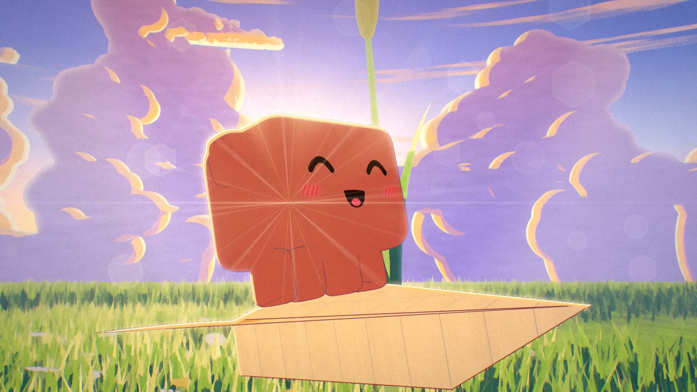
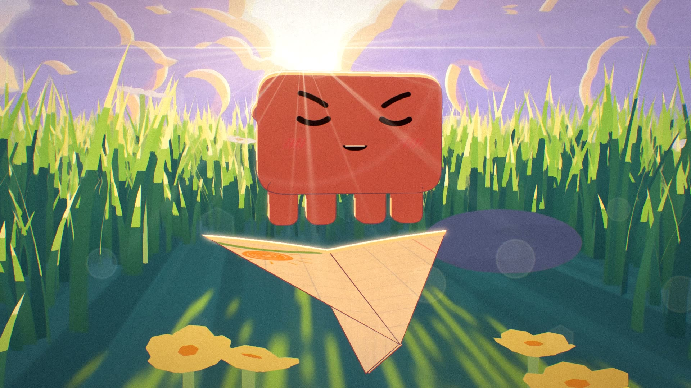
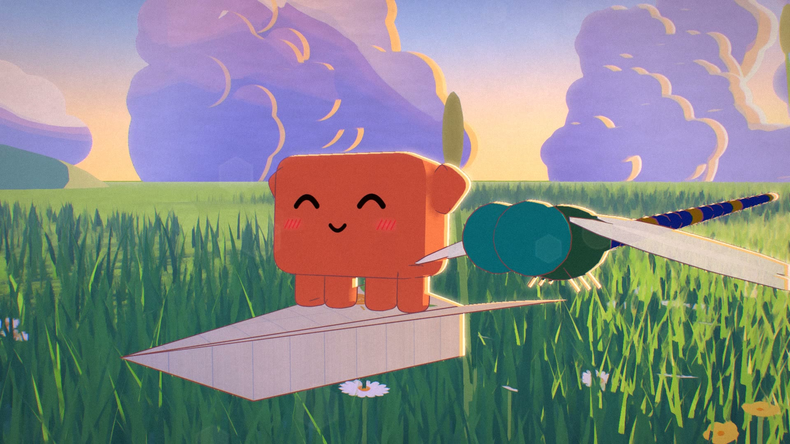
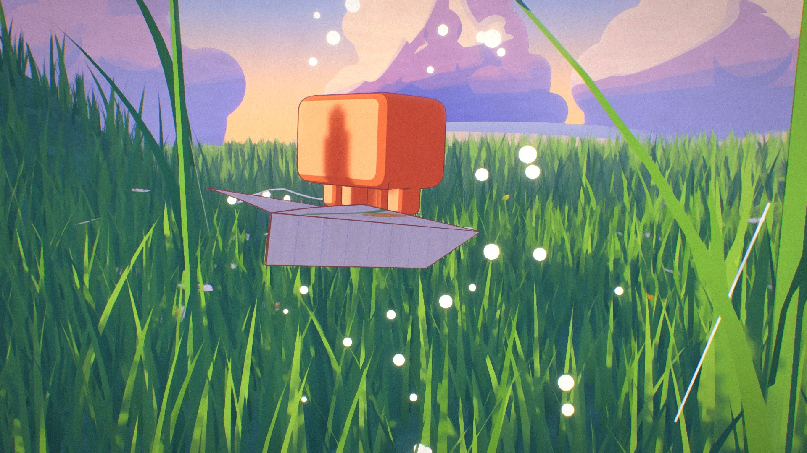
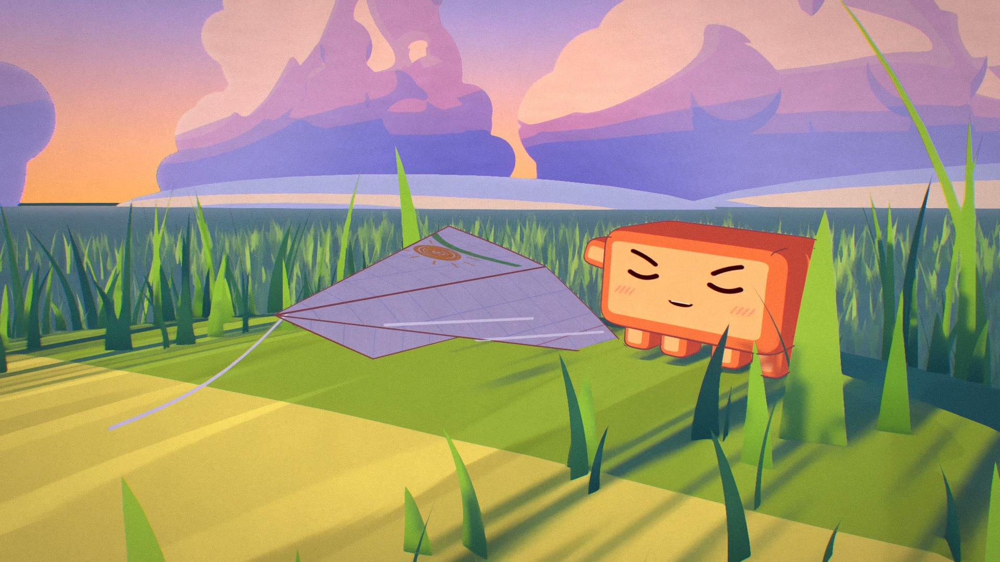
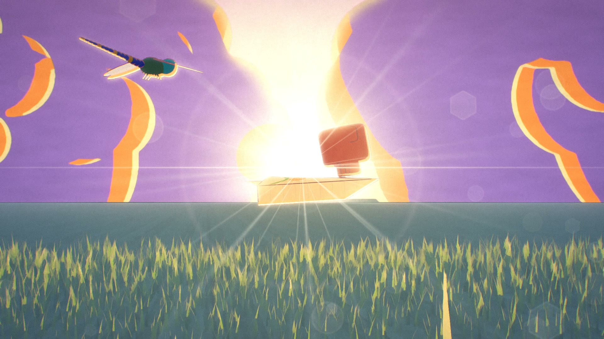
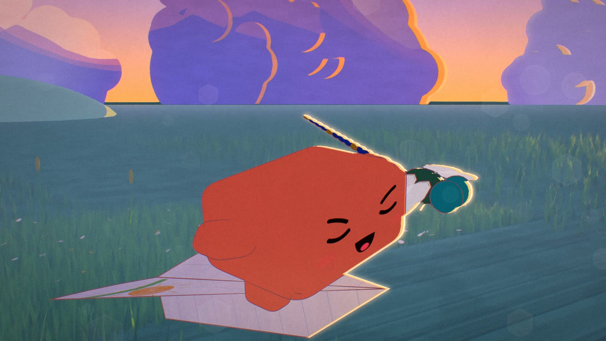

# PAPER PLANE

A 71-second anime short where every frame is made by code: no video model, no image model, no hand-drawn frames.
A tiny 2 cm cube wants to fly and flops face first into the grass. Then a paper plane folded from a notebook corner crashes
next to it. A gust lifts them over the meadow, a dew web soaks the left wing and the plane spirals into the shadow of a
hill. The sun is going down. The cube tows the plane up to the last strip of light, dries the wing, runs it off the cliff
edge... the plane drops out of sight, and the evening updraft lifts it into the sunset.



| | |
|---|---|
|  |  |
|  |  |
|  |  |

**Watch:** [film/paper-plane.mp4](film/paper-plane.mp4) (1920×1080, 24 fps, 71.5 s; click "View raw" to download).

Made with Claude Opus 5.5 in Claude Code.

---

## How it looks like anime

Blender builds the whole meadow from Python and renders it in Eevee at 32 samples. A second pass in numpy / OpenCV
finishes every frame:

| Pass | What it does |
|---|---|
| Eevee (Blender) | colour with cel light, a gouache filter on the background and ink lines on the hero only |
| finish (`finish.py`) | aerial haze, light wrap, a hard cel rim on the side facing the sun |
| light show | the sun's disc, crepuscular rays, bloom, lens flare, bokeh, steam off the drying wing |
| film | chromatic fringe, the grade, paper texture and grain |

* **Real scale.** Units are centimetres. Grass is taller than the hero, and the plane is a little longer than two of it.
* **Animation is on twos and threes.** Characters move on twos (12 drawings a second), effects on threes, the camera and
  the plane on every frame.
* **One plan, baked once.** `js/plan.mjs` holds every keyed track: pose, face, plane, wings, camera, dragonfly, pollen and
  wind. `kit/bake.mjs` writes one row per frame and Blender only reads it.
* **A clock you can see.** The sun sets for real, and the band of light climbs the hill while the hero pulls the plane up.
* **Checked before rendering.** `js/check.mjs` samples the hero, the plane and the camera on every frame against the ground,
  the stalks, the pebble and each other. It printed `clean` before the render.
* **The sound is fully synthesized** (`audio/score.mjs`): one flight theme in D major, with whoosh, splash, buzz, sneeze
  and laugh, all from code.

## Run it

Requirements: Blender 5.2 on `PATH`, Node 18+, Python 3.11+ with `numpy`, `opencv-python` and `playwright`, Google Chrome
(set `CHROME` if it is not in the default Windows place), and `ffmpeg`. Run everything from the repository root.

Bake the plan, check it and draw the faces:

```bash
node kit/bake.mjs .
node js/check.mjs
python kit/faces.py .
```

Preview one frame (frame, samples, scale in percent):

```bash
blender -b -P scene.py -- still 600 8 50
```

Render all 1,716 frames, finish them, synthesize the score and mux the film:

```bash
blender -b -P scene.py -- anim 32
python finish.py out/frames out/final 1 1716 3
node audio/score.mjs out/music.wav
ffmpeg -framerate 24 -start_number 1 -i out/final/f%04d.png -i out/music.wav -t 71.5 -c:v libx264 -crf 16 -pix_fmt yuv420p -c:a aac -b:a 256k paper-plane.mp4
```

## Layout

```
scene.py            the whole meadow, the plane, the web and the render setup in Blender
finish.py           the per-frame light show and film finish
paper.py            generates the paper texture
js/plan.mjs         the film: every keyed track, 15 shots
js/check.mjs        the per-frame clipping check
audio/score.mjs     the synthesized score
kit/                shared tools: Blender helpers, the mascot model and rig, the baker, the face drawer, the synth
tex/                painted sky plates, ground strokes and paper
docs/               stills and the storyboard (in Russian)
```

## License

MIT
